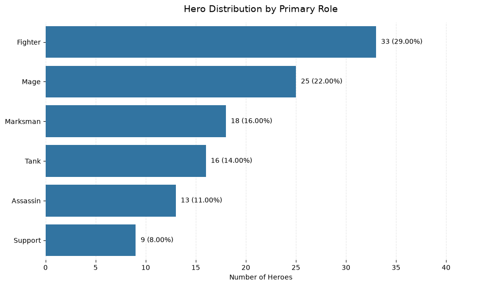
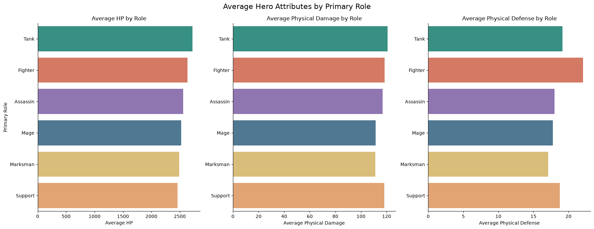
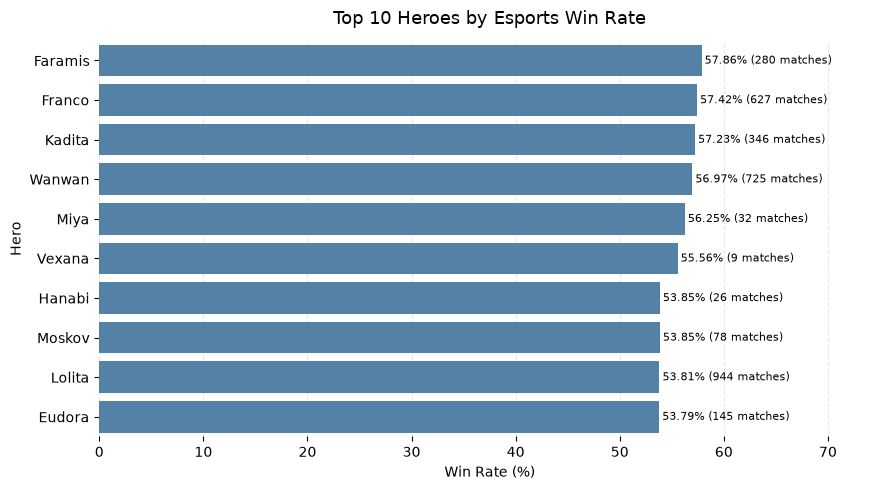
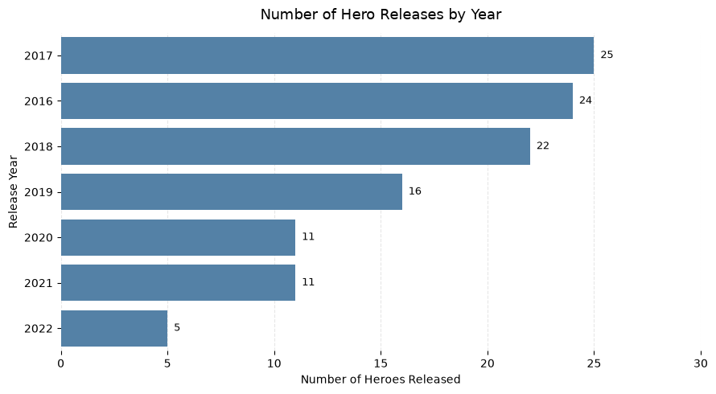
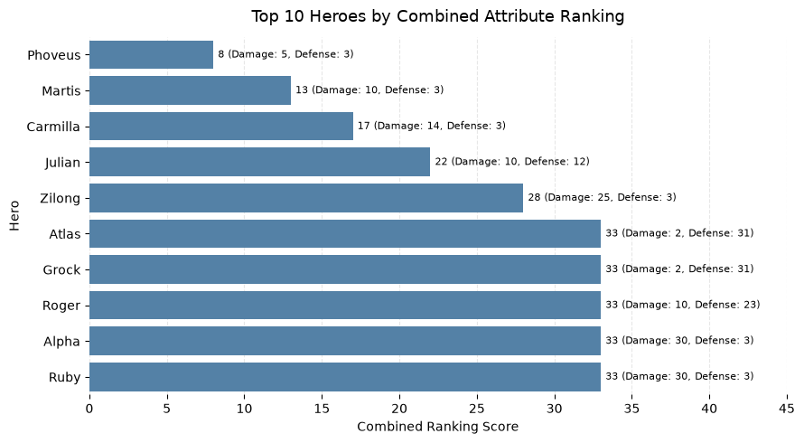

# Mobile Legends Heroes: Statistical and Esports Performance Analysis

# Introduction
This project focuses on Mobile Legends: Bang Bang (MLBB) hero and esports statistics. It explores five key areas: Hero Distribution by Role, Hero Statistics by Role, Esports Performance Analysis, Hero Release Trends, and Hero Attribute Ranking.

The dataset was sourced from [Kaggle](https://www.kaggle.com/datasets/kishan9044/mobile-legends-bang-bang?resource=download) and contains hero statistics up to Mobile Legends Version 1.7.20, released on September 20, 2022.
The dataset was stored locally in a PostgreSQL database for data management. SQL queries were used to create the database, create and modify tables, and extract data for analysis. The SQL scripts can be found in the [load_sql](/load_sql/) directory.

Python was also used to perform exploratory data analysis with Pandas and create data visualizations using Seaborn and Matplotlib. The code is available in the [notebook](/mlbb_eda.ipynb/), while the resulting charts can be viewed in the [charts_from_python](/charts_from_python/) directory.

# Background
As an MLBB player, I became curious about the game's heroes and wanted to better understand their roles, attributes, and competitive performance. This curiosity motivated me to explore the available hero statistics and gain a deeper understanding of the game's roster.

## Questions I Wanted to Answer Through SQL:

1. How many heroes belong to each primary role?
2. Which primary role has the highest average HP, physical damage, and physical defense?
3. Which heroes have the highest esports win rates?
4. How has the number of hero releases changed over the years?
5. Who are the top 10 heroes based on a combined offensive and defensive ranking?

# Tools I Used  
The following tools were used throughout the project to manage, query, analyze, and visualize the MLBB hero dataset:

- **SQL:** Used to query, filter, aggregate, and analyze the data to uncover meaningful insights.
- **PostgreSQL:** The database management system used to store and manage the MLBB hero dataset.
- **Visual Studio Code:** Used as the development environment for writing and executing SQL queries.
- **Git & GitHub:** Used for version control, tracking project changes, and maintaining the project repository.
- **Python (Pandas, Seaborn & Matplotlib):** Used for data manipulation, exploratory data analysis, and data visualization.
- **Jupyter Notebook:** Used to write and execute Python code for data analysis and visualization.


# The Analysis
Each SQL query was designed to explore a specific aspect of the MLBB Heroes Stats dataset, focusing on hero distribution, base attributes, esports performance, release trends, and combined offensive and defensive rankings. The following sections present the queries, results, and key insights from each analysis.


### 1. Hero Distribution by Role
To examine the composition of the MLBB hero roster by identifying how heroes are distributed across primary roles.

```
SELECT
    primary_role,
    COUNT(*) AS total_count,
    ROUND(
        COUNT(*) * 100.0 / 
        (SELECT COUNT(*) FROM mlbb_heroes)
    ) AS role_percentage
FROM
    mlbb_heroes
GROUP BY
    primary_role
ORDER BY
    total_count DESC;
```

**Key Insights:**

Fighters and Mages collectively account for approximately 51% of the entire hero population, indicating that more than half of the available hero roster belongs to these two roles. Meanwhile, Supports have the lowest representation, highlighting the uneven distribution of heroes across primary roles.
 
The dataset consists of 114 heroes distributed across six primary roles: Fighter, Mage, Marksman, Tank, Assassin, and Support.

- Fighters have the highest representation, with 33 heroes, accounting for 29% of the total hero population.

- Mages rank second with 25 heroes (22%), followed by Marksmen with 18 heroes (16%).

- Tanks account for 16 heroes (14%), while Assassins represent 13 heroes (11%).

- The analysis of the Mobile Legends: Bang Bang (MLBB) hero dataset revealed several patterns in hero distribution, base attributes, esports performance, and release trends.



| Primary Role | Total Count | Role Percentage |
|:-------------|------------:|----------------:|
| Fighter      | 33          | 29.0%           |
| Mage         | 25          | 22.0%           |
| Marksman     | 18          | 16.0%           |
| Tank         | 16          | 14.0%           |
| Assassin     | 13          | 11.0%           |
| Support      | 9           | 8.0%            |
| **Total**    | **114**     | **100.0%**      |


### 2. Hero Statistics by Role
To compare the average HP, physical damage, and physical defense across different hero roles and identify the attributes in which each role performs best.

```
SELECT
    primary_role,
    ROUND(AVG(hp), 2) AS average_hp,
    ROUND(AVG(physical_damage), 2) AS average_physical_damage,
    ROUND(AVG(physical_defense), 2) AS average_physical_defense
FROM mlbb_heroes
GROUP BY
    primary_role
ORDER BY
    average_hp DESC;
```

**Key Insights:**

The findings show differences in the average base attributes across hero roles. Tanks have the highest average HP and physical damage, reinforcing their strong overall attribute profile in these categories. Fighters, meanwhile, stand out for having the highest average physical defense. On the other hand, Marksmen recorded the lowest averages in both physical damage and physical defense, while Supports had the lowest average HP.
 
 - Tanks recorded the highest average HP at 2,722.19, followed by Fighters at 2,635.30 and Assassins at 2,559.92. Supports had the lowest average HP at 2,462.56.
 
- Tanks also recorded the highest average physical damage at 120.88, narrowly outperforming Fighters at 118.45 and Supports at 118.33. Marksmen had the lowest average physical damage at 111.17.

- Fighters had the highest average physical defense at 22.06, followed by Tanks at 19.13 and Supports at 18.78. Marksmen recorded the lowest average physical defense at 17.11.

- Tanks and Fighters generally lead in the three attributes analyzed. Tanks have the highest average HP and physical damage, while Fighters have the highest average physical defense.



| Primary Role | Average HP | Average Physical Damage | Average Physical Defense |
|:-------------|-----------:|------------------------:|-------------------------:|
| Tank         | 2722.19    | 120.88                  | 19.12                    |
| Fighter      | 2635.30    | 118.45                  | 22.06                    |
| Assassin     | 2559.92    | 116.92                  | 18.00                    |
| Mage         | 2523.16    | 111.48                  | 17.76                    |
| Marksman     | 2490.78    | 111.17                  | 17.11                    |
| Support      | 2462.56    | 118.33                  | 18.78                    |


### 3. Esports Performance Analysis
To identify the top-performing heroes in esports based on their win percentages and total matches played.

```
SELECT
    name,
    primary_role,
    esport_wins,
    esport_loss,
    esport_wins + esport_loss AS total_matches_played,
    ROUND(
        (esport_wins::NUMERIC /
        NULLIF(esport_wins + esport_loss, 0)) * 100,
        2
    ) AS win_rate
FROM mlbb_heroes
WHERE
    esport_wins + esport_loss > 0
ORDER BY
    win_rate DESC
LIMIT 10;
```

**Key Insights:**

The results show that Faramis had the highest win percentage among the top 10 heroes, while Lolita had the greatest number of esports appearances.
This highlights the distinction between win rate and match volume: a high win percentage does not necessarily mean a hero has been used more frequently or has demonstrated the same level of consistency across a larger number of matches.

- Faramis (Support) recorded the highest esports win rate at 57.86%, with 162 wins out of 280 matches. He was followed by Franco (Tank) at 57.42% and Kadita (Mage) at 57.23%.

- Lolita (Support) recorded the highest match volume among the top 10, with 944 matches played and a 53.81% win rate. This indicates that her performance was maintained across a considerably larger number of matches.

- Wanwan (Marksman) also demonstrated strong esports performance, recording 413 wins out of 725 matches and a 56.97% win rate.

- Marksmen accounted for 4 of the top 10 heroes, followed by 3 Mages, 2 Supports, and 1 Tank.

- Some heroes, such as Vexana and Miya, achieved relatively high win rates despite having considerably fewer esports appearances. Their results should be interpreted with caution because smaller match samples can make win rates less representative.



| Hero | Primary Role | Esports Wins | Esports Losses | Total Matches Played | Win Rate |
|:-----|:-------------|-------------:|---------------:|---------------------:|---------:|
| Faramis | Support | 162 | 118 | 280 | 57.86% |
| Franco | Tank | 360 | 267 | 627 | 57.42% |
| Kadita | Mage | 198 | 148 | 346 | 57.23% |
| Wanwan | Marksman | 413 | 312 | 725 | 56.97% |
| Miya | Marksman | 18 | 14 | 32 | 56.25% |
| Vexana | Mage | 5 | 4 | 9 | 55.56% |
| Hanabi | Marksman | 14 | 12 | 26 | 53.85% |
| Moskov | Marksman | 42 | 36 | 78 | 53.85% |
| Lolita | Support | 508 | 436 | 944 | 53.81% |
| Eudora | Mage | 78 | 67 | 145 | 53.79% |


### 4.  Hero Release Trends
To analyze the annual release trend of Mobile Legends heroes and identify the year with the highest number of hero releases.

```
SELECT
    CASE
        WHEN release_date ~ '^\d{4}'
            THEN LEFT(release_date, 4)
        WHEN release_date ~ '^\d{2}-\d{2}-\d{4}$'
            THEN RIGHT(release_date, 4)
    END AS release_year,
    COUNT(*) AS hero_count
FROM
    mlbb_heroes
GROUP BY
    release_year
ORDER BY
    hero_count DESC;
```

**Key Insights:**

MLBB experienced its highest rate of hero releases during its earlier years, particularly between 2016 and 2018. 
The subsequent decline suggests that the pace of introducing new heroes slowed over the years covered by the dataset.

- 2017 recorded the highest number of hero releases, with 25 heroes introduced, followed closely by 2016 with 24 heroes.

- In 2018, the number of new hero releases decreased slightly to 22, followed by a more noticeable decline to 16 in 2019.

- Hero releases continued to decrease in subsequent years, with 11 heroes introduced in both 2020 and 2021. By 2022, the number had dropped to only 5 heroes.

- Overall, the findings indicate a downward trend in annual hero releases, particularly after 2017. The number of new heroes introduced declined from 25 in 2017 to just 5 in 2022.



| Release Year | Hero Count |
|-------------:|-----------:|
| 2017         | 25         |
| 2016         | 24         |
| 2018         | 22         |
| 2019         | 16         |
| 2020         | 11         |
| 2021         | 11         |
| 2022         | 5          |


### 5. Hero Attribute Ranking
To identify the top 10 heroes with consistently high offensive and defensive rankings by combining their individual rankings into an overall score. A lower combined score indicates a stronger overall ranking.

```
WITH rankings AS (
SELECT
    name,
    primary_role,
    RANK() OVER (ORDER BY physical_damage + magic_damage DESC) AS damage_rank,
    RANK() OVER (ORDER BY physical_defense + magic_defense DESC) AS defense_rank
FROM mlbb_heroes
)

SELECT
    name,
    primary_role,
    damage_rank,
    defense_rank,
    damage_rank + defense_rank AS combined_stats
FROM rankings
ORDER BY
    combined_stats ASC,
    damage_rank ASC,
    defense_rank ASC
LIMIT 10;
```

**Key Insights:**

The results show that a strong combined ranking can come from different statistical strengths. Some heroes perform consistently well in both offense and defense,while others compensate for a weaker ranking in one category with a stronger ranking in the other. Phoveus stands out for having a relatively balanced and consistently high ranking across both categories.
 
- Phoveus (Fighter) ranked first overall with a combined score of 8, placing 5th in offensive ranking and 3rd in defensive ranking. This indicates consistently strong performance in both categories.

- Martis (Fighter) and Carmilla (Support) followed with combined scores of 13 and 17, respectively. Both ranked 3rd in defense, demonstrating particularly strong defensive rankings.

- Grock and Atlas (Tanks) ranked 2nd in offense but 31st in defense. Their strong offensive rankings contributed to their combined scores of 33.

- Alpha and Ruby (Fighters) ranked 3rd in defense but 30th in offense, showing the opposite performance pattern.

- Fighter was the most represented role, accounting for 7 of the top 10 heroes, followed by 2 Tanks and 1 Support.



| Hero | Primary Role | Damage Rank | Defense Rank | Combined Stats |
|:-----|:-------------|------------:|-------------:|---------------:|
| Phoveus | Fighter | 5 | 3 | 8 |
| Martis | Fighter | 10 | 3 | 13 |
| Carmilla | Support | 14 | 3 | 17 |
| Julian | Fighter | 10 | 12 | 22 |
| Zilong | Fighter | 25 | 3 | 28 |
| Atlas | Tank | 2 | 31 | 33 |
| Grock | Tank | 2 | 31 | 33 |
| Roger | Fighter | 10 | 23 | 33 |
| Alpha | Fighter | 30 | 3 | 33 |
| Ruby | Fighter | 30 | 3 | 33 |


# Conclusion

The hero distribution analysis showed that Fighters and Mages make up approximately 51% of the total hero population, making them the most represented roles. In terms of base attributes, Tanks recorded the highest average HP and physical damage, while Fighters had the highest average physical defense. These findings highlight the differences in attribute distributions across hero roles.

The esports performance analysis identified Faramis as the hero with the highest win rate among the top 10, while Lolita recorded the highest number of esports appearances within the same group. This demonstrated that win rate and match volume provide different perspectives when evaluating hero performance. Meanwhile, the hero attribute ranking identified Phoveus as having the best combined offensive and defensive ranking, with consistently high positions in both categories.

Lastly, the release trend analysis showed that 2017 had the highest number of hero releases, with 25 heroes introduced. However, the number of annual releases generally declined afterward, reaching only 5 heroes in 2022.

Overall, the findings highlight the differences in hero representation, attribute distributions, and esports performance across roles, while also showing how the MLBB hero roster evolved throughout the years covered by the dataset.